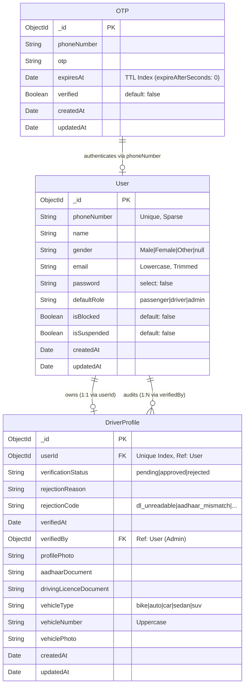

# PickMe — Database Schema Documentation

**Current Persistence Engine:** MongoDB (v7+) via Mongoose ODM (`9.9.1`)
**Connection Module:** [backend/src/config/database/mongodb.js](file:///c:/Projects/PickMe/backend/src/config/database/mongodb.js)
**Environment Variable:** `MONGODB_URI`

---

## 1. Schema Overview & Collections

The backend persistence layer currently defines **three active Mongoose models** in [backend/src/models/](file:///c:/Projects/PickMe/backend/src/models/):

| Model Name | Collection Name | Purpose | Primary References |
|---|---|---|---|
| [`User`](file:///c:/Projects/PickMe/backend/src/models/User.js) | `users` | Core identity, authentication credentials, role flag, account access status | Root identity entity |
| [`DriverProfile`](file:///c:/Projects/PickMe/backend/src/models/DriverProfile.js) | `driverprofiles` | Driver KYC onboarding, documents, verification status, vehicle attributes | Ref `User` (as `userId` and `verifiedBy`) |
| [`OTP`](file:///c:/Projects/PickMe/backend/src/models/OTP.js) | `otps` | Ephemeral one-time passwords for passwordless phone login with automated TTL | Indexed by `phoneNumber` |

> [!IMPORTANT]
> **Ride and Trip Persistence Reality:**
> There are currently **NO** database models for `Ride`, `Trip`, `Booking`, or `ScheduledRide` in the backend.
> All passenger ride booking, driver offer dispatch, trip progression, and fare settlement currently execute exclusively inside mobile client memory via the [ride-lifecycle.service.ts](file:///c:/Projects/PickMe/mobile-app/src/services/ride-lifecycle.service.ts) singleton. Persistent server-side ride schemas are scheduled for Phase C.

---

## 2. Model: `User` (`users` Collection)

Defined in [backend/src/models/User.js](file:///c:/Projects/PickMe/backend/src/models/User.js).
Represents all user identities across the platform: Passengers, Drivers, and Administrators.

### Field Definitions

| Field Name | Type | Required | Default | Enums / Constraints | Description |
|---|---|---|---|---|---|
| `_id` | `ObjectId` | Auto | Generated | Unique primary key | MongoDB internal document identifier. |
| `phoneNumber` | `String` | Conditional | None | Trimmed, Unique, Sparse | 10-digit mobile phone number. Required when `defaultRole !== "admin"`. |
| `name` | `String` | No | `""` | Trimmed | User's full name. Populated during driver onboarding or user profile update. |
| `gender` | `String` | No | `null` | `["Male", "Female", "Other", null]` | User's gender. Supports gender-sensitive ride preferences in future matching. |
| `email` | `String` | No | `""` | Lowercase, Trimmed | User's email address. Primary identifier for administrator authentication. |
| `password` | `String` | No | None | `select: false` | Bcrypt password hash for administrator credentials. Never returned in default queries. |
| `defaultRole` | `String` | No | `"passenger"` | `["passenger", "driver", "admin"]` | Current active user role. Updated to `"driver"` upon admin verification approval. |
| `isBlocked` | `Boolean` | No | `false` | Boolean flag | Account ban flag. When `true`, all requests receive HTTP `403 Forbidden`. |
| `isSuspended` | `Boolean` | No | `false` | Boolean flag | Temporary suspension flag. When `true`, requests receive HTTP `403 Forbidden`. |
| `createdAt` | `Date` | Auto | Generated | Managed by Mongoose | Timestamp when the user record was first created. |
| `updatedAt` | `Date` | Auto | Generated | Managed by Mongoose | Timestamp when the user record was last updated. |

### Indexes & Uniqueness Constraints
1. **`phoneNumber_1` (Unique, Sparse):**
   - Uniqueness ensures that each phone number can only belong to one user account.
   - Sparse indexing allows the administrator account (`defaultRole: "admin"`) to exist without a phone number or with an empty string without triggering index collisions.
2. **`_id_` (Unique Primary Key):**
   - Standard MongoDB primary key index.

### Role & Identity Handling
- **Passengers:** Register via OTP verification. Default role is `"passenger"`. `phoneNumber` is mandatory.
- **Drivers:** Begin as a user with `defaultRole: "passenger"`. Upon submitting onboarding and receiving administrative approval via `PUT /api/admin/drivers/:id/approve`, the server atomically mutates `defaultRole` to `"driver"`.
- **Administrators:** Identify via `email: "prathibanshiva@gmail.com"` and `defaultRole: "admin"`. May have empty `phoneNumber`. Passwords are encrypted with bcrypt.

---

## 3. Model: `DriverProfile` (`driverprofiles` Collection)

Defined in [backend/src/models/DriverProfile.js](file:///c:/Projects/PickMe/backend/src/models/DriverProfile.js).
Stores driver KYC submissions, document references, vehicle metadata, and administrative verification decisions.

### Field Definitions

| Field Name | Type | Required | Default | Enums / Constraints | Description |
|---|---|---|---|---|---|
| `_id` | `ObjectId` | Auto | Generated | Unique primary key | MongoDB internal document identifier. |
| `userId` | `ObjectId` | **Yes** | None | Ref: `"User"`, Unique, Indexed | Foreign key linking to the driver's parent `User` document. Exactly one profile per user. |
| `verificationStatus` | `String` | No | `"pending"` | `["pending", "approved", "rejected"]` | Current KYC lifecycle state. |
| `rejectionReason` | `String` | No | `""` | Trimmed | Human-readable explanation supplied by administrator when rejecting application. |
| `rejectionCode` | `String` | No | `""` | `["dl_unreadable", "aadhaar_mismatch", "plate_obscured", "expired_docs", "liveness_fail", "other", ""]` | Standardized rejection code for categorization and driver-facing remediation prompts. |
| `verifiedAt` | `Date` | No | `null` | Date timestamp | Date and time when the verification decision (approval or rejection) occurred. |
| `verifiedBy` | `ObjectId` | No | `null` | Ref: `"User"` | Foreign key recording the administrator who performed the approval or rejection. |
| `profilePhoto` | `String` | No | `""` | Trimmed URI / path | Driver face portrait photo (currently placeholder URI during local development). |
| `aadhaarDocument` | `String` | No | `""` | Trimmed URI / path | Government identity document (Aadhaar) reference. |
| `drivingLicenceDocument` | `String` | No | `""` | Trimmed URI / path | Official driver's licence document reference. |
| `vehicleType` | `String` | No | `null` | `["bike", "auto", "car", "sedan", "suv"]` | Vehicle category. Must match canonical vehicle taxonomy. |
| `vehicleNumber` | `String` | No | `""` | Uppercase, Trimmed | Registration plate number (e.g., `KA01AB1234`). |
| `vehiclePhoto` | `String` | No | `""` | Trimmed URI / path | Photo of the vehicle showing license plate. |
| `createdAt` | `Date` | Auto | Generated | Managed by Mongoose | Timestamp when the profile record was created. |
| `updatedAt` | `Date` | Auto | Generated | Managed by Mongoose | Timestamp when the profile record was last updated. |

### Indexes & Uniqueness Constraints
1. **`userId_1` (Unique Index):**
   - Enforces a strict 1-to-1 relationship between `User` and `DriverProfile`. A user cannot register multiple driver profiles.
2. **`_id_` (Unique Primary Key):**
   - Standard MongoDB primary key index.

### Verification Lifecycle Behavior
- **Initialization:** Created automatically via `POST /api/driver/profile` with `verificationStatus: "pending"` upon driver role entry.
- **Submission:** Updated via `PUT /api/driver/profile` with required personal and vehicle fields. If already `"approved"`, updates are rejected by controller guards.
- **Admin Approval:** Via `PUT /api/admin/drivers/:id/approve`. Requires current status to be `"pending"`. Sets `verificationStatus: "approved"`, stamps `verifiedAt`, records `verifiedBy: req.user._id`, and syncs `User.defaultRole` to `"driver"`.
- **Admin Rejection:** Via `PUT /api/admin/drivers/:id/reject`. Requires current status to be `"pending"`. Requires non-empty `rejectionReason`. Sets `verificationStatus: "rejected"`, records `rejectionCode`, `verifiedAt`, and `verifiedBy`. Driver can resubmit with corrected documents, transitioning status back to `"pending"`.

---

## 4. Model: `OTP` (`otps` Collection)

Defined in [backend/src/models/OTP.js](file:///c:/Projects/PickMe/backend/src/models/OTP.js).
Handles temporary verification tokens for passwordless phone authentication.

### Field Definitions

| Field Name | Type | Required | Default | Constraints | Description |
|---|---|---|---|---|---|
| `_id` | `ObjectId` | Auto | Generated | Primary key | MongoDB internal document identifier. |
| `phoneNumber` | `String` | **Yes** | None | Trimmed | Target phone number for verification. |
| `otp` | `String` | **Yes** | None | String code | 6-digit numeric verification code generated cryptographically or via utility. |
| `expiresAt` | `Date` | **Yes** | None | Date timestamp | Expiration deadline (typically 5 minutes from generation). |
| `verified` | `Boolean` | No | `false` | Boolean flag | Indicates whether this OTP was successfully verified. Single-use guard. |
| `createdAt` | `Date` | Auto | Generated | Managed by Mongoose | Document creation timestamp. |
| `updatedAt` | `Date` | Auto | Generated | Managed by Mongoose | Document update timestamp. |

### Indexes & Automatic Deletion (TTL)
1. **`expiresAt_1` (TTL Index with `expireAfterSeconds: 0`):**
   - Configured via: `otpSchema.index({ expiresAt: 1 }, { expireAfterSeconds: 0 })`.
   - MongoDB background TTL monitor automatically purges expired OTP documents from the collection once `expiresAt` passes.

---

## 5. Entity Relationship Diagram (Mongoose)

---

## 6. Persisted vs In-Memory State Analysis

| Feature Domain | Database Model | Persistent Storage | Current Reality / Implementation |
|---|---|---|---|
| Passenger Identity | `User` | MongoDB `users` | Fully persisted in MongoDB. Authenticated with JWT. |
| Driver KYC Data | `DriverProfile` | MongoDB `driverprofiles` | Fully persisted in MongoDB. Documents stored as reference strings. |
| Driver Approval/Rejection | `DriverProfile` | MongoDB `driverprofiles` | Fully persisted with admin ID and rejection reasons. |
| Account Banning/Suspension | `User` | MongoDB `users` | Fully persisted. Enforced on every authenticated API call. |
| Phone OTP Verification | `OTP` | MongoDB `otps` | Fully persisted with automatic TTL expiry. |
| **Ride Booking Record** | **None** | **None** | **Client Memory Only:** Managed in [ride-lifecycle.service.ts](file:///c:/Projects/PickMe/mobile-app/src/services/ride-lifecycle.service.ts) singleton. |
| **Scheduled Ride Queue** | **None** | **None** | **Client Memory Only:** Pre-booking persistence is scheduled for Phase C. |
| **Driver Location Stream** | **None** | **None** | **Client Memory Only:** Mock coordinate stream in mobile service (`driverLocation`). |
| **Ride PIN / OTP** | **None** | **None** | **Client Memory Only:** Static verification PIN (`"7294"`) in mock session. |
| **Trip Fare Settlement** | **None** | **None** | **Client Memory Only:** Aggregated in memory on driver device (`todayEarnings`). |

---

## 7. Known Differences Between Design Blueprint & Current Schema

1. **Document Storage:**
   - *Blueprint:* Mentions Cloudinary integration for Aadhaar, driving licence, vehicle photos, and profile pictures.
   - *Current Schema:* Document fields are standard `String` URIs. In local development, these store placeholder strings (`placeholder_aadhaar_doc`, etc.) as Cloudinary upload middleware is not yet wired to endpoints.
2. **Geospatial Indexing:**
   - *Blueprint (ADR-007):* Planned MongoDB `2dsphere` index for driver location tracking and geospatial queries.
   - *Current Schema:* No geospatial coordinates are stored on `User` or `DriverProfile`. Driver locations currently exist only in mobile memory.
3. **Ride Models:**
   - *Blueprint:* Envisions dynamic ride matching and persistent trip states.
   - *Current Schema:* No `Ride` or `Trip` schema exists yet. Backend admin endpoints `/api/admin/rides` and `/api/admin/scheduled-rides` explicitly return empty persisted sets (`persisted: false`, `phase: "Phase C Scheduled"`).
